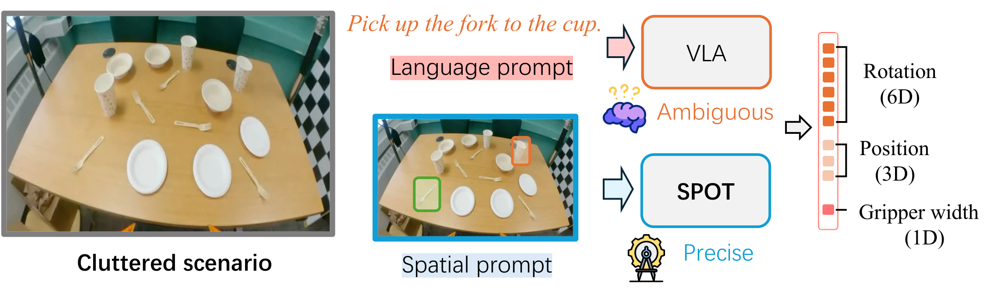
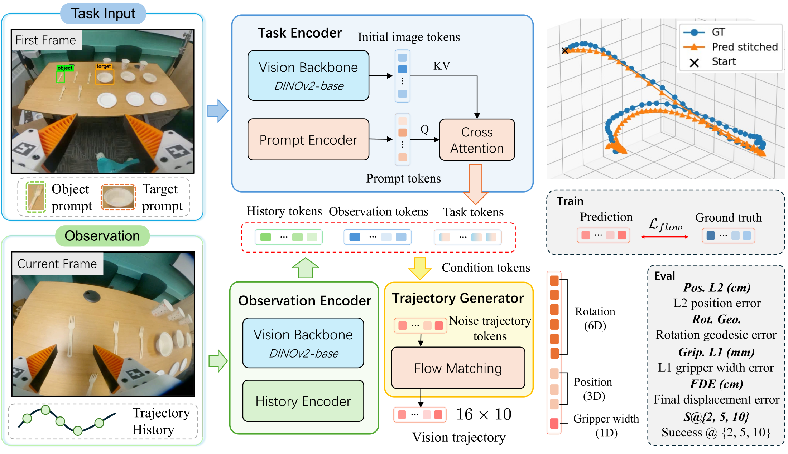

<h1 align="center">
  Spatially Prompted Visual Trajectory Prediction<br />
  for Egocentric Manipulation
</h1>

<p align="center"><strong>WACV 2027</strong></p>

<p align="center">
  <a href="https://jackyfl.github.io/">Yifan Li</a><sup>1,*</sup>,
  <a href="https://scholar.google.com/citations?user=AcPskncAAAAJ">Xinyu Zhou</a><sup>1,*</sup>,
  <a href="https://gyhandy.github.io/">Yunhao Ge</a><sup>2</sup>,
  <a href="https://www.egr.msu.edu/~xbtan/">Xiaobo Tan</a><sup>1</sup>,
  <a href="https://www.egr.msu.edu/~yukong/">Yu Kong</a><sup>1</sup>
</p>

<p align="center">
  <sup>1</sup> Michigan State University &nbsp; <sup>2</sup> NVIDIA Research<br />
  <sup>*</sup> Equal contribution
</p>

<p align="center">
  <a href="https://jackyfl.github.io/SP-VTP-project-page/static/spvtp-paper.pdf"><strong>Paper</strong></a> ·
  <a href="https://arxiv.org/abs/2605.20085"><strong>arXiv</strong></a> ·
  <a href="https://jackyfl.github.io/SP-VTP-project-page/"><strong>Project Page</strong></a> ·
  <a href="https://huggingface.co/datasets/JackYFL233/EgoSPT"><strong>Dataset</strong></a> ·
  <a href="https://jackyfl.github.io/SP-VTP-project-page/#overview"><strong>Demo Video</strong></a>
</p>

<p align="center">
  <a href="https://jackyfl.github.io/SP-VTP-project-page/#overview">
    
  </a>
</p>
<p align="center"><em>Specify what to pick and where to place it with spatial prompts. Click the image to watch the dataset demo.</em></p>

## Overview

Research code for **SP-VTP**, **EgoSPT**, and **SPOT**. A fixed first-frame
object–target specification conditions future EE trajectory prediction from
the current image and recent motion history, without an explicit object tracker.

- **SP-VTP:** spatially prompted visual trajectory prediction.
- **EgoSPT:** 2,841 egocentric fork pick-and-place episodes across three scenes.
- **SPOT:** a policy combining visual/coordinate prompts, current RGB, and four
  history states to predict a 16-step, 10D relative EE trajectory chunk.

The repository supports data collection, processing and annotation, SPOT
training, external VLA adapters, and offline evaluation. Repository access is
currently **private**; datasets, model weights, and experiment artifacts are not
bundled. See the [project page](https://jackyfl.github.io/SP-VTP-project-page/#results)
for results and evaluation protocols.

## Method

<p align="center">
  
</p>

The task encoder fuses rendered boxes and coordinate tokens into a fixed task
representation. The observation encoder supplies current-frame features and
recent EE history; a flow-matching decoder generates future translation,
rotation, and gripper-width waypoints. Each waypoint is relative to the chunk
origin, not an incremental transform from the previous waypoint.

## Installation

```bash
git clone git@github.com:JackYFL/SP-VTP.git
cd SP-VTP

uv venv --python 3.10
source .venv/bin/activate
uv pip install -e .
uv pip install -e '.[data,annotation]'  # optional processing / annotation tools
```

Run from the project root. The Python package and CLI are `spvtp`; after
updating an existing installation, rerun `uv pip install -e .`.
`python -m spvtp --help` also works. Match PyTorch to your CUDA installation.
Camera SDKs and external VLA runtimes are optional and are not imported by
ordinary SPOT training/evaluation. Install `.[iphone]` on the Record3D capture
machine; OAK requires DepthAI 2.x.

## Data collection and preparation

Download [EgoSPT](https://huggingface.co/datasets/JackYFL233/EgoSPT) and point
`data.root` and `data.annotations_json` to your local data and annotation paths.
To collect and annotate new demonstrations:

```bash
spvtp collect --backend iphone-gopro --data-dir recordings/session.zarr --fps 30
spvtp process --backend iphone-gopro --config /path/to/session.yaml
spvtp annotate --video /path/to/camera_1.mp4
spvtp merge-annotations --root /path/to/EgoSPT --output annotations_merged.json
```

Capture backends: `iphone-gopro`, `iphone-oak`, `iphone`. Keys: `s` start,
`w` save, `a` discard/restart, `q` exit. Processing requires the selected rig's
calibration. See [data and alignment](spvtp/vision_traj/docs/dataset_analyze.md).

## Training

```bash
spvtp train data.root=/path/to/EgoSPT data.annotations_json=/path/to/annotations.json \
  train.output_dir=runs/spot

# Two GPUs: 16 x 4 accumulation x 2 processes = global batch 128.
accelerate launch --num_processes 2 --multi_gpu -m spvtp.vision_traj.scripts.train \
  data.root=/path/to/EgoSPT data.annotations_json=/path/to/annotations.json \
  train.grad_accum_steps=4 train.output_dir=runs/spot
```

Defaults: frozen DINOv2-Base, flow matching, D=768, H=16, K=4, lr=2e-4,
30 epochs. One GPU uses batch 16 × accumulation 8. `data.split_seed=42`
is independent of `train.seed`. Use `--config FILE` and/or `key=value` overrides;
`train.max_steps` limits a smoke run. See [training](spvtp/vision_traj/docs/training.md)
and [model/prompt definitions](spvtp/vision_traj/docs/model_arch.md).

## Evaluation

### Independent windows

```bash
spvtp eval --ckpt runs/spot/ckpt_final.pt --output-dir runs/spot/eval \
  --batch-size 32 --save-step-metrics --viz-samples 12
```

Loads checkpoint configuration and its adjacent split manifest; evaluates the
full validation split by default, writing overall and per-scene results.
Relocate data with `--data-root`, `--annotations`, and `--frame-cache-root`.
History is recorded ground truth, not previous predictions. Console distances
are cm; stored distances remain meters with explicit unit metadata. See
[metrics and outputs](spvtp/vision_traj/docs/evaluation.md).

### Sequential predicted-state feedback

```bash
spvtp rollout --ckpt runs/spot/ckpt_final.pt \
  --split-manifest runs/spot/split_manifest.json --output-dir runs/spot/rollout
```

The default evaluates recorded history, predicted history with GT pose anchors,
and cumulative predicted poses. **RGB remains recorded replay:** predictions do
not change future images or object states. Episode-end FDE is distinct from the
fixed-16-step FDE above. Neither protocol measures closed-loop robot task success.
See the [rollout protocol](spvtp/vision_traj/docs/rollout.md).

### VLA adapters

Adapters are provided for GR00T N1.6, π0.5, SmolVLA, and OpenVLA-OFT. Start with
`spvtp vla --help`, then select a backend, e.g. `spvtp vla smolvla --help`.
Input modalities and fine-tuning settings are backend-specific; consult the
[experiment notes](spvtp/vision_traj/docs/experiment.md).

## Development and documentation

```bash
OMP_NUM_THREADS=2 python -m unittest discover -s spvtp/vision_traj/tests -q
OMP_NUM_THREADS=2 python -m unittest discover -s tests -q
```

`spvtp --help` lists commands; `spvtp COMMAND --help` shows their options.
See the [documentation index](spvtp/vision_traj/docs/README.md) for reusable
interfaces, controlled experiments, and GPU validation notes. The root
`pyproject.toml` is the only package/dependency specification; flat aliases such
as `spvtp.vision_traj.train` remain available within the new namespace.

## Citation

If this work is useful for your research, please cite:

```bibtex
@inproceedings{li2027spvtp,
  title={Spatially Prompted Visual Trajectory Prediction for Egocentric Manipulation},
  author={Li, Yifan and Zhou, Xinyu and Ge, Yunhao and Tan, Xiaobo and Kong, Yu},
  booktitle={Winter Conference on Applications of Computer Vision (WACV)},
  year={2027}
}
```
